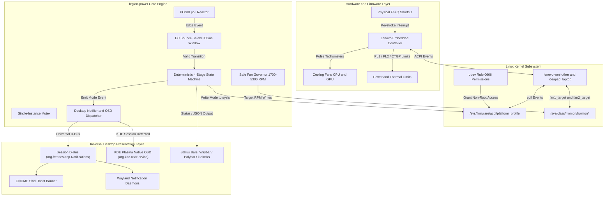

# Lenovo Legion Power Manager (`legion-power`)

[](https://en.wikipedia.org/wiki/C%2B%2B20)
[](LICENSE)
[](https://kernel.org)
[](#)

A high-performance C++ power profile manager, fan controller, and background event watcher for Lenovo Legion laptops (verified on Lenovo Legion Pro 5 16IAX10, Intel Core Ultra 9 275HX + NVIDIA RTX 5070 running Linux / CachyOS / Arch / Fedora / Ubuntu / Debian).

---

## About

`legion-power` is an open-source, native Linux power management utility and hardware event daemon engineered specifically for Lenovo Legion laptops (such as the Legion Pro 5 16IAX10).

The project was developed to bridge the gap between Lenovo's proprietary hardware features and the Linux desktop experience. Modern Legion laptops feature advanced Embedded Controller (EC) capabilities—including dynamic power envelope scaling (PL1/PL2 burst limits, GPU Dynamic Boost), manual fan target overrides, and multi-stage thermal profiles. `legion-power` provides a lightweight, sub-millisecond C++20 daemon that integrates these hardware features directly into standard Linux desktop environments (KDE Plasma, GNOME, Hyprland, Sway, XFCE, and i3) while maintaining 0.00% idle CPU overhead and zero runtime dependencies beyond standard system libraries.

---

## Overview

On Lenovo Legion laptops, the physical power button LED glows continuously to reflect the active power profile. When the LED is physically disabled or masked to prevent glare and eye strain, users lose visual feedback on the active power state.

In addition, the factory Embedded Controller (EC) firmware restricts the physical **Fn+Q** keyboard shortcut to a three-mode loop (`Quiet` -> `Balanced` -> `Performance`), omitting `Extreme / Max Power` mode entirely from the keyboard shortcut.

`legion-power` addresses these limitations:
1. **Virtual Power Button Indicator:** Serves as a virtual replacement for the physical LED by dispatching auto-dismissing on-screen displays (OSD) and desktop notifications.
2. **Extended Fn+Q Loop:** Transparently intercepts hardware cycle events to integrate `Extreme / Max Power` into the physical keyboard shortcut (`Quiet` -> `Balanced` -> `Performance` -> `Extreme` -> `Quiet`).
3. **Hardware Debounce Shield:** Suppresses firmware microcode register bounce-backs that would otherwise cause `Extreme` mode to revert to `Quiet`.
4. **Safe Fan Speed Governor:** Manages CPU and GPU fan RPM targets via official kernel interfaces with strict hardware floor and ceiling enforcement.
5. **Universal Desktop Compatibility:** Integrates natively with KDE Plasma, GNOME, Hyprland, Sway, XFCE, Cinnamon, MATE, LXQt, and standalone window managers (i3, bspwm).
6. **Auto-Expiring Notifications:** Dispatches lightweight 1.5-second alerts with transient flags and synchronous replacement tags to prevent notification backlog.
7. **Comprehensive Telemetry:** Reports live fan RPMs, sustained (PL1) and burst (PL2) CPU power limits, and GPU CTGP / Dynamic Boost parameters.

---

## System Architecture

### Architectural Diagram



### Component Flow

```text
+--------------------------------------------------------------------------------+
|                        1. Hardware & Firmware Layer                            |
|                                                                                |
|  [Physical Keyboard]                 [Embedded Controller (EC)]                |
|     Fn+Q Keystroke   =============>    Firmware Mode Cycle                     |
|                                        Tachometer / PWM Fan Control            |
|                                        Power & Thermal Limits (PL1/PL2/CTGP)   |
+--------------------------------------------------------------------------------+
                                       ||
                                       || ACPI WMI Events
                                       \/
+--------------------------------------------------------------------------------+
|                        2. Linux Kernel Subsystem                               |
|                                                                                |
|  Drivers: lenovo-wmi-other, ideapad_laptop                                     |
|  Sysfs Interfaces:                                                             |
|    - /sys/firmware/acpi/platform_profile         (Platform power profile)      |
|    - /sys/class/hwmon/hwmon*                     (Dual fan tachs & targets)   |
|  Udev Rules:                                                                   |
|    - /etc/udev/rules.d/99-legion-power.rules     (0666 non-root write access)  |
+--------------------------------------------------------------------------------+
                                       ||
                                       || POSIX poll() [POLLPRI | POLLERR]
                                       \/
+--------------------------------------------------------------------------------+
|                        3. legion-power Daemon Engine                           |
|                                                                                |
|  [Single-Instance Lock]           [Event Reactor]                              |
|    flock() Mutex Guard              POSIX poll() (< 0.5 ms event latency)      |
|                                                                                |
|  [EC Bounce Shield]               [Deterministic State Machine]                |
|    Filters trailing writes (<350ms) Quiet -> Balanced -> Performance -> Extreme|
|                                                                                |
|  [Fan Governor]                   [Desktop Notification Dispatcher]            |
|    Clamped 1700 - 5300 RPM Target   Freedesktop D-Bus (sd-bus) + KDE Plasma OSD|
+--------------------------------------------------------------------------------+
                                       ||
                                       || Freedesktop Notifications / D-Bus
                                       \/
+--------------------------------------------------------------------------------+
|                        4. Desktop Presentation Layer                           |
|                                                                                |
|  KDE Plasma:          Native OSD (org.kde.osdService) + Transient Notification |
|  GNOME Shell:         Auto-dismiss toast banner (Synchronous tag replacement)  |
|  Hyprland / Sway:     Waybar (JSON module / click action) + Dunst/Mako/SwayNC  |
|  XFCE / Cinnamon:     Desktop notification daemon + XDG Autostart entry       |
|  i3 / bspwm:          Polybar (IPC custom script) / i3blocks                   |
+--------------------------------------------------------------------------------+
```

---

## Power Profiles and Hardware Specifications

| Mode ID | Name | Virtual LED | Indicator | Acoustic & Thermal Target | Sustained PL1 / Burst PL2 |
| :--- | :--- | :---: | :---: | :--- | :---: |
| `low-power` | **Quiet Mode** | Blue | 🔵 | Reduced TDP, quiet fan acoustics, maximum battery lifespan. | ~45W / 70W |
| `balanced` | **Balanced Mode** | White | ⚪ | Intelligent dynamic power curves, automatic fans for daily tasks. | ~70W / 125W |
| `performance` | **Performance Mode** | Red | 🔴 | High clocks, aggressive cooling, elevated TDP for gaming. | ~100W / 140W |
| `max-power` | **Extreme / Max Power** | Purple | 🟣 | Maximum sustained wattage, 125W+ PL2, GPU dynamic boost unlocked. | 125W+ / 175W+ |
| `custom` | **Custom Profile** | Cyan | 🟠 | User-defined fan curves and manual thermal limits. | User-defined |

---

## Desktop Environment Integration

`legion-power` operates across diverse desktop environments and display servers:

| Environment | Notification Handler | OSD Overlay Support | Autostart Mechanism | Status Bar Integration |
| :--- | :--- | :---: | :--- | :--- |
| **KDE Plasma** (Wayland / X11) | Freedesktop D-Bus (`org.freedesktop.Notifications`) | Native KDE OSD (`org.kde.osdService`) | systemd user unit + XDG autostart | Native system tray / runner |
| **GNOME Shell** (Wayland / X11) | Freedesktop D-Bus with synchronous tag | Native Adwaita toast banner | systemd user unit + XDG autostart | Top bar extensions / CLI |
| **Hyprland** (Wayland) | Dunst, Mako, SwayNC, or Fnott | SwayNC / Dunst visual toast | systemd user unit + XDG autostart | **Waybar** (JSON module) |
| **Sway** (Wayland) | Mako, Dunst, or SwayNC | Mako / SwayNC toast | systemd user unit + XDG autostart | **Waybar** / Swaybar |
| **XFCE** (X11) | `xfce4-notifyd` | xfce4-notifyd OSD | XDG autostart (`~/.config/autostart`) | xfce4-genmon-plugin |
| **Cinnamon / MATE** (X11) | Cinnamon / MATE notification daemon | Native desktop toast | systemd user unit + XDG autostart | Applet / CLI |
| **i3 / bspwm / AwesomeWM** (X11) | Dunst or deadd-notification-center | Dunst OSD | XDG autostart (`dex -a` or `.xprofile`) | **Polybar** / i3blocks |

### Notification Protocol Details
- **Freedesktop Specification Compliance:** Sends notifications via direct asynchronous `sd-bus` method calls.
- **Auto-Dismiss:** Configured with `urgency = 1` (normal) and `transient = true` (1500 ms timeout) so notifications dismiss automatically without persisting in tray history.
- **Synchronous Replacement:** Emits `x-canonical-private-synchronous: legion-power-mode` and updates `replaces_id` in-place, preventing notification queuing when rapidly cycling modes.
- **Single-Instance Mutex:** Protected by kernel-level `flock()` on `/tmp/legion-power-watcher-<uid>.lock` to ensure multiple autostart mechanisms never spawn competing daemon instances.

---

## Status Bar Integration

### 1. Waybar (Hyprland / Sway)
Add the module definition to `~/.config/waybar/config.jsonc`:

```jsonc
"custom/power_profile": {
    "exec": "legion-power json",
    "return-type": "json",
    "format": "{icon} {}",
    "format-icons": {
        "low-power": "🔵",
        "balanced": "⚪",
        "performance": "🔴",
        "max-power": "🟣",
        "custom": "🟠"
    },
    "interval": 2,
    "on-click": "legion-power next",
    "tooltip": true
}
```

Add styling to `~/.config/waybar/style.css`:

```css
#custom-power_profile {
    padding: 0 10px;
    margin: 0 4px;
    border-radius: 8px;
    background-color: rgba(30, 30, 46, 0.8);
    font-weight: bold;
}
```

### 2. Polybar (i3 / bspwm / X11)
Add the module definition to `~/.config/polybar/config.ini`:

```ini
[module/power-mode]
type = custom/script
exec = legion-power short
interval = 2
click-left = legion-power next
format = <label>
format-foreground = #ffffff
```

### 3. i3blocks
Add to `~/.config/i3blocks/config`:

```ini
[power-mode]
command=legion-power short
interval=2
signal=10
```

---

## Fn+Q State Machine

The factory Lenovo EC firmware natively cycles between three states. `legion-power` deterministically extends the hardware cycle to include `Extreme / Max Power` (Purple) without skipping `Balanced` (White):

| Current Mode | Trigger | Hardware EC Native Response | `legion-power` Action | Resolved Active State | Virtual LED |
| :--- | :---: | :--- | :--- | :--- | :---: |
| **Quiet Mode** (`low-power`) | **Fn+Q** | Transitions sysfs to `balanced` | Leaves sysfs untouched, records state | **Balanced Mode** (`balanced`) | ⚪ White |
| **Balanced Mode** (`balanced`) | **Fn+Q** | Transitions sysfs to `performance` | Leaves sysfs untouched, records state | **Performance Mode** (`performance`) | 🔴 Red |
| **Performance Mode** (`performance`) | **Fn+Q** | Wraps sysfs to `low-power` | Intercepts wrap, writes `max-power` to sysfs | **Extreme Mode** (`max-power`) | 🟣 Purple |
| **Extreme Mode** (`max-power`) | **Fn+Q** | EC event detected | Advances to `low-power`, writes to sysfs | **Quiet Mode** (`low-power`) | 🔵 Blue |

> **EC Bounce Shield:** Within 350 ms of entering `Extreme` mode, Lenovo EC microcode may emit a trailing register write back to `low-power`. The debounce shield drops this echo, holding Extreme mode active until the next physical keypress.

---

## Hardware Protection and Safety

`legion-power` adheres to strict safety boundaries:
- **No Direct Port Writing:** Never writes raw bytes to `/dev/port`, `/dev/mem`, or undocumented EC registers.
- **Kernel-Managed Interfaces:** Interacts exclusively through standard `/sys/class/hwmon/` and `/sys/firmware/acpi/` interfaces supplied by `lenovo-wmi-other` and `ideapad_laptop`.
- **Hardware-Enforced Fan Bounds:** Clamps fan targets strictly between the hardware limits reported by the machine (`1700 RPM` minimum, `5300 RPM` maximum). Fans cannot be stopped or under-driven.
- **Thermal Safeguards Intact:** Hardware EC and CPU PROCHOT thermal trip-points remain authoritative in silicon. If thermal thresholds are approached, the EC overrides software fan requests automatically.
- **Fail-Safe Restoration:** Executing `legion-power fan auto` immediately returns 100% of fan control back to the Lenovo EC firmware.

---

## Performance Specifications

- **Language:** Native C++20.
- **Optimization:** `-O3 -march=native -flto -DNDEBUG`.
- **Binary Footprint:** ~89 KB stripped binary.
- **Memory Consumption:** `< 1.2 MB` RSS in daemon mode.
- **CPU Utilization:** `0.00%` while idle. Employs POSIX kernel `poll()` on `/sys/firmware/acpi/platform_profile` (`POLLPRI | POLLERR`) with a 200 ms safety-net heartbeat.
- **Event Latency:** Sub-millisecond (`< 0.5 ms`) event response from physical **Fn+Q** press to notification delivery.
- **Memory Safety:** Audited with GCC AddressSanitizer (`-fsanitize=address,undefined` with `detect_leaks=1`). Zero memory leaks, zero buffer overflows.

---

## Installation

Clone the repository and run the installation script:

```bash
git clone https://github.com/Siwach777/lenovo-power-manager.git
cd lenovo-power-manager
./install.sh
```

The script performs the following tasks:
1. Stops active daemon instances and cleanly unlinks binaries (preventing `Text file busy` errors).
2. Detects, stops, and masks conflicting legacy services.
3. Builds the optimized binary (`-O3 -march=native -flto`).
4. Installs the executable to `/usr/local/bin/legion-power` (with alias `power-manager`).
5. Installs udev rules (`/etc/udev/rules.d/99-legion-power.rules`) for non-root mode switching.
6. Configures and starts the systemd user service (`legion-power-watcher.service`).
7. Installs the Freedesktop XDG autostart entry (`~/.config/autostart/legion-power-watcher.desktop`) for standalone window managers (Sway, Hyprland, XFCE).
8. Sends a verification test notification.

---

## Command-Line Interface

### Dashboard Readout
```bash
legion-power
# or: power-manager
```
Output:
```text
┌────────────────────────────────────────────────────────┐
│          Lenovo Legion Pro 5 - Power Manager           │
└────────────────────────────────────────────────────────┘

  Current Mode:    ⚪ Balanced Mode (balanced)
  Virtual LED:     White LED indicator
  Description:     Automatic thermal management, balanced fan curves for daily tasks.
  Status:          Dynamic & Balanced

  --- Hardware Telemetry ---
  Fans:            CPU: 3200 RPM  |  GPU: 3200 RPM
  Power Limits:    PL1 (Sustained): 70W  PL2 (Burst): 125W  GPU CTGP: 80W (+15W Boost)
  Conservation:    Enabled (Preserving battery lifespan ~80%)

Tip: Fn+Q cycles Quiet -> Balanced -> Performance -> Extreme (max-power).
```

### Fan Control
```bash
# Display fan speeds, limits, and active target
legion-power fan

# Set manual fan speed (clamped between 1700 and 5300 RPM)
legion-power fan set 3500

# Restore automatic EC fan curve management
legion-power fan auto

# Maximum safe cooling (5300 RPM)
legion-power fan max
```

### Raw Mode Query
```bash
legion-power current
# Output: balanced
```

### Short Readout
```bash
legion-power short
# Output: ⚪ Balanced Mode [White]
```

### JSON Output
```bash
legion-power json
```
Output:
```json
{
  "mode": "balanced",
  "name": "Balanced Mode",
  "led_color": "White",
  "led_emoji": "⚪",
  "summary": "Dynamic & Balanced",
  "fan1_rpm": 3200,
  "fan2_rpm": 3200,
  "fan1_target": 0,
  "fan2_target": 0,
  "pl1_spl_watts": 70,
  "pl2_sppt_watts": 125,
  "gpu_ctgp_watts": 80,
  "gpu_boost_watts": 15,
  "conservation_mode": true
}
```

### Profile Switching
```bash
legion-power set performance
legion-power set balanced
legion-power next     # Cycles Quiet -> Balanced -> Performance -> Extreme -> Quiet
```

### Service and Autostart Commands
```bash
legion-power install-service     # Installs systemd user unit
legion-power uninstall-service   # Removes systemd user unit
legion-power install-autostart   # Installs XDG autostart entry (~/.config/autostart)
legion-power uninstall-autostart # Removes XDG autostart entry
legion-power install-udev        # Configures passwordless udev rules
```

### Notification Test
```bash
legion-power test-notify         # Defaults to 1500 ms auto-dismiss
legion-power test-notify 2000    # Custom duration (2000 ms)
```

---

## Uninstallation

To remove all binaries, systemd units, XDG autostart files, and udev rules:

```bash
./uninstall.sh
```

---

## License

GPL-3.0 License. See [LICENSE](LICENSE) for details.
